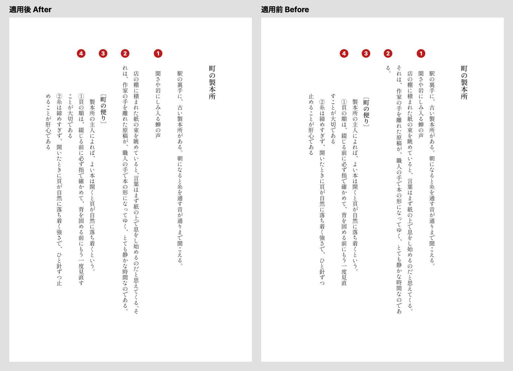

# book-typesetter

**v0.2.4**

An Agent Skill that acts as the typesetter who finishes a Japanese book. It measures the page, compares it with the source, and solves layout problems without touching the author's words. You can ask in English: it is meant for anyone working on a Japanese book, including people who read little Japanese.

> Change no words. Absorb the problem with space.

日本語は下にあります / Japanese follows below.

---

## Before and after



*Vertical text reads from right to left, so read the right page first. The text is a fictional sample written for this repository, typeset twice with the same software and settings except for the four changes below. A person applied the techniques by hand following the skill; this is not the raw output of a skill run.*

| # | Before | After | Technique |
|---|---|---|---|
| 1 | The haiku sits between paragraphs and does not stand out | One blank line before and after | Space in whole-line units |
| 2 | 「る。」 spills onto its own line | No stray line; the paragraph is one line shorter | Tighten two punctuation marks by half an em (9.8pt → 4.9pt) to pull in one character |
| 3 | The heading looks low because a full-width 〔 is empty in its upper half | The ink of 〔 lines up with the top of the quotation | Raise the box by half its size (0.55 em) |
| 4 | Wrapped lines stick out one character above the numbered heads | Heads and wrapped lines start at the same height | Remove the first-line indent from numbered items |

The stray line in row 2 appeared with the settings used here (DesignCraft, full-width punctuation). In InDesign and Word the default settings fit the same line without it; Word appears to do so by hanging punctuation, and the stray line returned when that was turned off. More samples and the numbers are in [examples/](examples/).

## Where this comes from

In the days of metal type, a Japanese book was made by hand. One worker walked the racks and picked out each character. Another stood the characters in lines and set them into a page. A line rarely came out the right length on its own, so the compositor slipped small blanks of metal, called *komemono*, between the characters until the line locked tight.

Readers never saw those blanks. A page that read easily was the only trace they left.

Authors do not write with page breaks in mind. A paragraph may run two characters too long, or a heading may land on the last line of a page. The compositor did not ask the author to change the sentence. The problem was solved with metal and space, and the author's words stayed free.

The metal is gone, and software now does most of this work. Software still leaves things behind, though. This skill began while resetting an old book, when a paragraph ended in a line of just two characters, 「る。」. It looked like something to live with. It was not. Three punctuation marks on the line before gave up a third of an em each, 3.27pt three times over, which made room for one more character. The stray line disappeared, and no reader will ever know it was there.

That is the craft this skill tries to keep: measure, find the room that is already on the page, and leave the words alone.

## What it does

The skill follows the same order every time:

1. Look at the finished page, not the settings.
2. Measure character positions. Never quote a number by eye.
3. Compare with the source, if there is one.
4. Find the cause: this line, this page, the flow from an earlier page, or a book-wide rule.
5. Try the lightest technique first, and calculate whether it will work before trying it.
6. Check the side effects: later pages, and anything the author or editor has already approved.
7. Recommend one option, with its cost.
8. Compare with the previous version mechanically, then hand over to a separate proofreader.

It never proposes rewriting the text to make a page fit.

## Where it works

The skill is a set of instructions, not a typesetting tool. A person can apply these techniques by hand. The point of the skill is that an AI agent can measure the page, decide, and, where it can drive the layout software, apply the change itself.

| Where | What it can do | Checked so far |
|---|---|---|
| DesignCraft | The agent measures, decides, and resets the page through the command line. It applies a character-spacing table to one paragraph; the software then works out the exact tightening | Used on one real book |
| InDesign | The agent can drive it by script (ExtendScript through AppleScript on a Mac), set the page, and export a PDF to measure | Tried on the sample with InDesign 2025. Spacing, heading, and numbered items worked. The stray line never appeared, because the default settings already fit 「る。」 on the line. Not used on a whole book |
| Word | Decide whether to keep its automatic hanging punctuation. If not, tighten with character spacing on each punctuation mark | Tried on the sample, and a person checked the screen. By default the stray line did not appear. With hanging punctuation turned off it appeared, and tightening removed it. The agent could not read the PDF that Word exported on this Mac, so these results are by eye |
| Fixed-layout EPUB | The same decisions as the print page | Not checked in readers |
| Reflowable EPUB, the web | Out of scope: lines change with each reader's device | — |

## Getting started

Copy this folder to your skills directory. For Claude Code:

```sh
git clone https://github.com/StateToolsLab/book-typesetter.git ~/.claude/skills/book-typesetter
```

Then ask about the layout in your own words. The skill answers in your language, shows the characters from the page, and gives the Japanese term once, so you can talk to a printer or editor.

- "Page 4 of this PDF ends with a line of just two characters. Can you tighten it?"
- "Is this heading too low compared with the scan of the original?"
- 「この 1 字、詰められない？」

Measuring PDFs works best with poppler (`pdftotext`, `pdftoppm`, `pdffonts`).

```
SKILL.md                      role, order of judgment, how to answer, what not to do
references/techniques.md      techniques from lightest to heaviest, with formulas and numbers
references/measuring.md       how to measure PDFs and scans
references/glossary.md        Japanese typesetting terms in English
references/tools-designcraft.md  example tools and settings for DesignCraft (scripts not included)
tests/acceptance-cases.md     what a good answer looks like
examples/                     the before-and-after sample
```

The skill's documents are written in Japanese, except the [glossary](references/glossary.md). Your agent reads them; you do not have to. For the underlying rules in English, see W3C's [Requirements for Japanese Text Layout](https://www.w3.org/TR/jlreq/).

## How this was built

book-typesetter is made by StateToolsLab with AI assistance. It was drafted with Claude (Anthropic) from the decisions made while resetting one vertical-text reprint, where a person pointed out each problem, chose among the options, and checked every version. AI proposes; people review and decide.

## Status and verification

Version 0.2.4 is an early draft. It comes from one A5 vertical-text book and was tried on two real layout questions, one of them also run without the skill. On that question the answer without the skill was also good; the skill added another option (expanding a line to absorb a short one), and its main value so far is a repeatable order and written-down techniques. One English question from a reader who knows little Japanese was also tried on the sample page: the answer found the cause, gave the calculation in English, and said what it could not check, though its predicted line break was not the one the software chose when the page was actually set. It has not yet been used through a whole book, and horizontal text, reflowable EPUB, and other typesetting software were not tested.

## License

[MIT License](LICENSE). Copyright (c) 2026 StateToolsLab.

---

# book-typesetter（日本語）

日本語の本を仕上げる、組版の担当の Agent Skill です。頁を測り、原本と見比べ、作家の言葉に手を入れずに頁の問題を解きます。

> 文字は変えない。余白と空きで受け止める。

## ビフォーアフター

上の画像が、同じ文章を組んだ比較です。縦組なので、右の頁（適用前）から読んでください。文章はこのリポジトリのために書いた架空のサンプルで、組版ソフトも設定も、下の 4 点のほかは同じです。スキルの手順に沿って人が技を当てて組んだもので、スキルの実行結果をそのまま載せたものではありません。

| # | 適用前 | 適用後 | 技 |
|---|---|---|---|
| 1 | 俳句が地の文に埋もれている | 前後を 1 行ずつあける | 行単位のあき |
| 2 | 「る。」だけの行が出る | 短い行が消え、段落が 1 行減る | 約物 2 か所を半字ずつ詰めて（9.8pt → 4.9pt）、1 字を前の行へ入れる |
| 3 | 全角の「〔」は上半分が空くので、見出しが下がって見える | 「〔」の字の頭が引用の天にそろう | 箱を字の半分（0.55 字）上げる |
| 4 | 番号の折り返しが 1 字上に出て、はみ出して見える | 番号の頭と折り返しが同じ高さ | 番号の項目の段落頭の下げを外す |

2 の「る。」の行は、ここで使った設定（DesignCraft、句読点は全角）で出たものです。InDesign と Word では、初期設定のままで同じ行に収まりました。Word はぶら下げで収めているようで、切ると「る。」の行が出ました。詳しくは [examples/](examples/) を見てください。

## このスキルの由来

金属活字の時代、日本語の本は人の手で組まれていました。棚を歩いて字を 1 本ずつ拾う職人がいて、その字を行に並べて頁にする職人がいました。行はそのままではちょうどの長さにならないので、職人は字の間に「込め物」という小さな金属の片を差し込み、行がきっちり締まるまで整えました。

読者が込め物を目にすることはありません。読みやすい頁だけが、その跡として残ります。

作家は頁の切れ目を考えて書いているわけではありません。段落が 2 字だけ余ることも、見出しが頁の最後の行に来ることもあります。そんなとき、職人は作家に文を変えてくれとは言わず、金属と空きで解決しました。だから作家の言葉は自由でいられました。

金属の片はなくなり、今はたいていの調整をソフトウェアがします。それでも、残るものはあります。このスキルは、古い本を組み直していたときに始まりました。ある段落の終わりが「る。」の 2 字だけの行になり、仕方がないように見えました。けれど前の行の句読点 3 つが 1/3 字ずつ（3.27pt ずつ）空きを譲ると、1 字分の余地ができて、短い行は消えました。読者がそれに気づくことはありません。

測ること、頁の中にすでにある余地を見つけること、言葉には手を触れないこと。このスキルが受け継ごうとしているのは、その仕事です。

## 何をするか

毎回、同じ順番で進めます。

1. 設定ではなく、出来上がった頁を見る。
2. 字の位置を測る。目測で数字を言わない。
3. 原本があれば見比べる。
4. 原因を切り分ける（その行、その頁、前の頁からの流れ、本全体の決まり）。
5. 軽い技から当てる。効くかどうかを先に計算する。
6. 影響を調べる（後ろの頁、すでに「良い」と言われた所）。
7. おすすめを 1 つ、代償と一緒に出す。
8. 前の版と機械で比べ、別の担当の校閲へ回す。

頁に収めるために文を書き換える案は出しません。

## どこで使えるか

このスキルは手順書で、組版の道具ではありません。同じ技は人の手でも当てられます。このスキルの狙いは、AI が頁を測って判断し、組版ソフトを動かせる環境なら、詰めるところまで AI が行えることです。

| 使う場所 | できること | 確かめた範囲 |
|---|---|---|
| DesignCraft | AI がコマンドで測り、判断し、組み直す。段落に文字組みの表を当てると、詰める量はソフトが計算する | 実際の本 1 冊で使いました |
| InDesign | AI がスクリプトで動かして組み、PDF に書き出して測る（Mac では AppleScript 経由の ExtendScript） | InDesign 2025 でサンプルを試しました。あき、見出し、番号の項目は効きました。「る。」の行は、初期設定のままで 1 行に収まって出ませんでした。本 1 冊では使っていません |
| Word | 自動のぶら下げを残すか判断する。残さないなら、句読点ごとに字間を指定して詰める | サンプルで試し、人が画面で確かめました。初期設定では「る。」の行は出ず、ぶら下げを切ると出て、詰めると消えました。この Mac では Word が書き出した PDF を AI が読めなかったので、結果は目視です |
| 固定レイアウトの EPUB | 紙の頁と同じ判断 | 読書アプリでの表示は見ていません |
| リフロー型の EPUB、Web | 対象外です。読者の端末で行が変わります | — |

## 使い方

スキルのフォルダに置きます。Claude Code の場合:

```sh
git clone https://github.com/StateToolsLab/book-typesetter.git ~/.claude/skills/book-typesetter
```

あとは「この 1 字、詰められない？」「この見出しの高さ、原本と比べて」のように、ふだんの言葉で相談してください。英語でも相談できます。PDF を測るには poppler（`pdftotext`、`pdftoppm`、`pdffonts`）があると進めやすくなります。

## 作り方について

StateToolsLab が AI の支援を受けて作りました。縦組の復刻本を 1 冊組み直したときの判断をもとに、Claude（Anthropic）と下書きしました。その本では、人が問題を指摘し、案を選び、版ごとに確かめました。

## 状態と検証

0.2.4 は初期の下書きです。A5 縦組の本 1 冊から作り、実際の相談 2 件で試しました。そのうち 1 件はスキルなしでも試し、スキルなしでも答えはよいものでした。スキルで増えたのは別の案（行を広げて短い行を解く案）で、今のところの主な価値は、手順が毎回そろうことと、技が文書に残ることです。日本語の読めない人を想定した英語の相談も、サンプルの頁で 1 件試しました。原因を見つけ、計算を英語で示し、確かめていない所も書きました。ただ、予想した行の切れ目は、実際に組んだ切れ目とは違いました。本 1 冊を通して使った実績はまだありません。横組、リフロー型の EPUB、ほかの組版ソフトでは試していません。

## ライセンス

[MIT License](LICENSE). Copyright (c) 2026 StateToolsLab.
